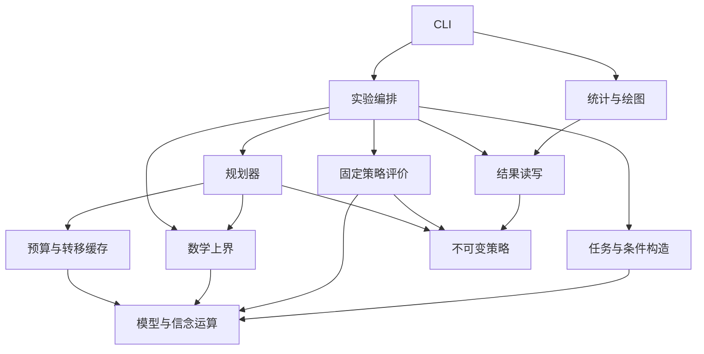

# RL Project

有限时域贝叶斯决策研究：能力改变后如何解释历史测试，并在成本与计算预算下决定是否重测。

第二版交付（2026-11-17）：[报告正文](docs/report_v2.md) · [结论—证据—决策台账](EVIDENCE_LEDGER.md) · [PPT交接](docs/ppt_handoff_v2.md) · [成果包](artifacts/handoff-v2-20261117/README.md) · [下载ZIP](artifacts/handoff-v2-20261117.zip)。第二版保留全部原始实验，新增机制分析、针对性诊断及技术/报告审阅。

每轮影响决策的实验后，记录它支持的断言、效应及误差、替代解释和下一步。随机任务平均差使用逐比较95%配对区间；精确计算核验数值误差；探索性分层不写成一般规律。证据不足时选择针对性验证或收窄断言，不按显著性追加样本。具体规则见[研究冲刺协议](RL_PROJECT_RESEARCH_SPRINT.md)。

- [研究计划、实验协议与验收](Guideline.md)
- [项目架构、模块边界与数据流](docs/architecture.md)
- [完整架构计划（存档）](docs/architecture-plan.md)
- [理论证明](docs/theory.md)
- [验证状态与结果索引](docs/results.md)
- [贡献记录](docs/contributions.md)
- [原项目提案](Proposal.md)
- [课程项目要求](Project_Requirements.md)

## 环境

需要 uv 和 Python 3.11。以下变量将项目产生的环境、缓存和临时文件保留在项目目录；在项目根目录执行：

```sh
mkdir -p .cache/uv .cache/python .cache/matplotlib .tmp
export UV_CACHE_DIR="$PWD/.cache/uv"
export UV_PYTHON_INSTALL_DIR="$PWD/.cache/python"
export XDG_CACHE_HOME="$PWD/.cache"
export MPLCONFIGDIR="$PWD/.cache/matplotlib"
export TMPDIR="$PWD/.tmp"
uv sync --locked --group dev
uv run pytest
```

## 实验入口

```sh
uv run rl-retest prepare --config configs/study.json --suite dev --out artifacts/dev
uv run rl-retest run --run-dir artifacts/dev --workers 1
uv run rl-retest verify --run-dir artifacts/dev
uv run rl-retest analyze --run-dir artifacts/dev
```

正式实验使用相同入口和冻结配置。`artifacts/` 包含可续跑的任务、原始结果和生成的表图；该目录默认不纳入 Git。

CLI 在加载数值库之前将常见 BLAS/OpenMP 线程数设为 1；并行批处理的计时标记为可能受争抢，单核计时应使用 `--workers 1`。正式运行前应固定源码和配置，并保存对应提交及运行清单。


## 文件层级和依赖
```text
RL_project/
├── AGENTS.md                         # 开发约束
├── Guideline.md                      # 研究目标、实验协议、阶段验收
├── README.md                         # 安装、入口命令、复现导航
├── Proposal.md                       # 原提案，保留原位置
├── Proposal.pdf
├── Project_Requirements.md           # 原课程要求，保留原位置
├── Project_Requirements.pdf
├── pyproject.toml                    # 包元数据、依赖、CLI、pytest 配置
├── uv.lock
├── .python-version                  # Python 3.11
├── .gitignore
│
├── docs/
│   ├── architecture.md              # 当前架构：边界、接口和数据流
│   ├── architecture-plan.md         # 完整架构计划存档
│   ├── theory.md                    # T1–T5 证明及其实现对应关系
│   ├── results.md                   # 报告论证、实测结论、证据索引
│   └── contributions.md             # 实际完成与交叉复核记录
│
├── configs/
│   └── study.json                   # 开发、主实验、大规模、压力与消融配置
│
├── src/
│   └── rl_retest/
│       ├── __init__.py
│       ├── cli.py                   # 命令解析与流程调用
│       ├── model.py                 # 模型类型、历史、信念与纯数学运算
│       ├── policy.py                # 不可变 Stop/Test 策略
│       ├── bounds.py                # 完美信息上界、成本上界、停止判据
│       ├── evaluation.py            # 固定策略评价、类型重采样混合评价
│       ├── analysis.py              # 配对统计、结果表、图表
│       │
│       ├── planners/
│       │   ├── __init__.py
│       │   ├── common.py            # 预算、转移缓存、计数器、PlanResult
│       │   ├── dynamic.py           # 精确 DP、前瞻、myopic、迭代加深
│       │   ├── blinkered.py         # 单路径限制规划及滚动策略构造
│       │   └── bounded.py           # 上下界搜索与检查点
│       │
│       └── experiments/
│           ├── __init__.py
│           ├── tasks.py             # 配置展开、任务生成、记忆与压力条件
│           ├── runner.py            # 方法选择、运行、计时、并行与续跑
│           └── records.py           # 实验记录、策略编解码、文件读写
│
├── tests/
│   ├── oracle.py                    # 独立有理数联合枚举实现
│   ├── cases.py                     # 解析例子和固定边界用例
│   ├── test_core.py                 # 模型、规划、上界和评价测试
│   ├── test_experiments.py
│   └── test_architecture.py          # 依赖方向与验证器独立性
│
├── .github/
│   └── workflows/
│       └── ci.yml                   # 安装、核心测试、小型流程检查
│
├── artifacts/                       # 自动生成，默认不纳入 Git
│   └── <run_id>/
│       ├── manifest.json            # 配置快照、来源版本、环境、哈希
│       ├── tasks.jsonl              # 固定任务数据
│       ├── jobs.jsonl               # 应执行的任务与方法组合
│       ├── records/
│       │   └── <job_id>.jsonl        # 原始结果、完整策略、预算检查点
│       ├── analysis/
│       │   ├── tables/
│       │   └── figures/
│       └── run.log
│
├── .venv/                           # 项目环境，忽略
├── .cache/                          # 工具与绘图缓存，忽略
└── .tmp/                            # 测试和原子写入临时文件，忽略
```



## 实验数据流

```text
configs/study.json
    ↓ prepare：生成并冻结配置快照、任务和作业
manifest.json + tasks.jsonl + jobs.jsonl
    ↓ 按作业构造两套独立输入
PlanningProblem（规划模型）      EvaluationContext（真实条件模型）
    ↓ 规划                              ↑
完整 Policy + 模型内价值／上下界 ── 固定策略真实评价
    ↓ run：按作业保存结果和完整策略
records/<job_id>.jsonl
    ├── verify：读取保存的策略，重新计算价值并检查记录
    └── analyze：读取原始记录，生成配对统计、表格和图表
```

- **任务与信念**：历史由固定的潜在路径类型产生；规划器只接收规划信念，真实条件信念单独用于评价。`correct`、`reset`、`misread` 在任务层构造。
- **策略与评价**：每个终止节点保存具体路径，测试节点保存成功和失败两个后续分支。评价器执行已保存的路径，不根据真实信念重新选路。
- **预算与检查点**：规划器共用后继信念计算的缓存与计数规则。大规模搜索和迭代加深在一次运行中保存多个预算检查点；等价方法复用结果时，记录中标明来源。
- **结果与复现**：每个作业独立保存 JSONL 分片，续跑跳过成功作业并重试失败作业。清单记录配置、任务、作业、源码和锁文件的哈希；规划或评价源码变化后需要准备新的运行目录。统计分析读取已有记录，分析代码的来源另行记录。
- **研究边界**：当前实验使用已知能力对应的成功概率表，DPO 是研究动机；正式 3240 个主任务及大规模、压力测试已完成，结果见 [验证状态与结果索引](docs/results.md)。

## 文档导航

[Guideline.md](Guideline.md) 定义研究任务和验收标准；[架构文档](docs/architecture.md) 描述当前实现的边界和接口；[完整架构计划](docs/architecture-plan.md) 保留实施前的方案；[理论证明](docs/theory.md)、[结果索引](docs/results.md) 和[贡献记录](docs/contributions.md) 分别维护证明、实测状态和实际工作。

## 正式成果（2026-11-17）

[完整成果包](artifacts/handoff-20261119/README.md) · [PPT交接](artifacts/handoff-20261119/PPT_HANDOFF.md) · [结果索引](artifacts/handoff-20261119/RESULTS.md)。正式种子为20261123，详情见 docs/execution-20261117.md。
