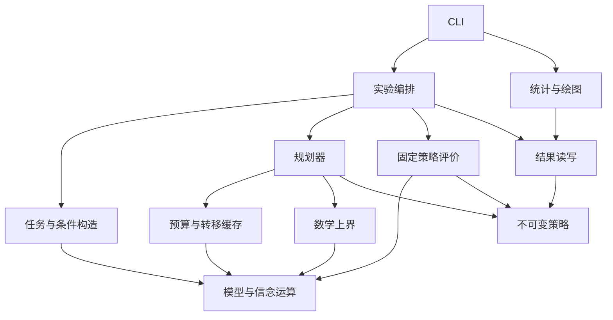

# RL_project 整体目录与架构设计（计划存档）

> 本文保存实施前确认的完整架构计划。目录树和阶段描述反映当时的目标设计；当前文件和实现状态以 [README](../README.md)、[架构文档](architecture.md) 和 [结果索引](results.md) 为准。

## 1. 架构决策

**先确定整个项目的文件层级、依赖方向和数据契约，再实现算法。采用一个可安装的 Python 包，按研究职责划分模块，统一管理实验配置和结果。**

计划制定时已重新阅读 `AGENTS.md`。当时仓库只有原始文档、`Guideline.md` 和开发准则，尚无代码。本设计细化 Guideline 的六类职责，研究方案和实验配置保持不变。

架构围绕四个需要长期稳定的边界：

1. **数学模型与实验流程分开**：后验更新、策略计算不读取文件、不启动进程。
2. **策略与规划器分开**：保存的策略可以在没有搜索器的情况下读取、执行和评价。
3. **规划与真实评价分开**：规划器只获得允许使用的模型，真值数据由实验层单独交给评价器。
4. **原始结果与统计分析分开**：修改图表或统计方法无需重新运行规划。

开源复用采用以下决策：

| 能力 | 选型 |
|---|---|
| 数值计算、随机数 | NumPy |
| 测试、参数化用例 | pytest |
| 绘图 | Matplotlib |
| 环境与依赖锁定 | uv、`pyproject.toml`、`uv.lock` |
| CLI、数据类型、缓存、并行、序列化 | Python 标准库 |
| 专用规划算法 | 基于既定递推实现，复用统一转移与预算组件 |

已核查的 [`pomdp_py`](https://h2r.github.io/pomdp-py/html/api/pomdp_py.algorithms.html) 提供采样规划器及小规模显式枚举的 ValueIteration；直接接入仍需适配本项目的因子化信念、完整策略证书和计算计量。[POMDPs.jl](https://github.com/JuliaPOMDP/POMDPs.jl) 则引入另一套语言与求解器生态。因此采用上述基础组件，保留本项目特有的规划实现。

## 2. 完整目标目录

下面是实施前设计的目标目录。文件随对应功能实现时创建，避免预先铺设大量空文件。

```text
RL_project/
├── AGENTS.md                         # 开发约束
├── Guideline.md                      # 研究目标、实验协议、阶段验收
├── README.md                         # 安装、入口命令、复现导航
├── Proposal.md                       # 原提案，保留原位置
├── Proposal.pdf
├── Project_Requirements.md           # 原课程要求，保留原位置
├── Project_Requirements.pdf
├── pyproject.toml                    # 包元数据、依赖、CLI、pytest 配置
├── uv.lock
├── .python-version                  # Python 3.11
├── .gitignore
│
├── docs/
│   ├── architecture.md              # 架构：边界、接口、数据流、变更理由
│   ├── theory.md                    # T1–T5 证明及其实现对应关系
│   ├── results.md                   # 报告论证、实测结论、证据索引
│   └── contributions.md             # 实际完成与交叉复核记录
│
├── configs/
│   └── study.json                   # 开发、主实验、大规模、压力与消融配置
│
├── src/
│   └── rl_retest/
│       ├── __init__.py
│       ├── cli.py                   # 命令解析与流程调用
│       ├── model.py                 # 模型类型、历史、信念与纯数学运算
│       ├── policy.py                # 不可变 Stop/Test 策略
│       ├── bounds.py                # 完美信息上界、成本上界、停止判据
│       ├── evaluation.py            # 固定策略评价、类型重采样混合评价
│       ├── analysis.py              # 配对统计、结果表、图表
│       │
│       ├── planners/
│       │   ├── __init__.py
│       │   ├── common.py            # 预算、转移缓存、计数器、PlanResult
│       │   ├── dynamic.py           # 精确 DP、前瞻、myopic、迭代加深
│       │   ├── blinkered.py         # 单路径限制规划及滚动策略构造
│       │   └── bounded.py           # 上下界搜索与检查点
│       │
│       └── experiments/
│           ├── __init__.py
│           ├── tasks.py             # 配置展开、任务生成、记忆与压力条件
│           ├── runner.py            # 方法选择、运行、计时、并行与续跑
│           └── records.py           # 实验记录、策略编解码、文件读写
│
├── tests/
│   ├── oracle.py                    # 独立有理数联合枚举实现
│   ├── cases.py                     # 解析例子和固定边界用例
│   ├── test_model.py
│   ├── test_planners.py
│   ├── test_bounds.py
│   ├── test_evaluation.py
│   ├── test_experiments.py
│   └── test_architecture.py          # 依赖方向与验证器独立性
│
├── .github/
│   └── workflows/
│       └── ci.yml                   # 安装、核心测试、小型流程检查
│
├── artifacts/                       # 自动生成，默认不纳入 Git
│   └── <run_id>/
│       ├── manifest.json            # 配置快照、来源版本、环境、哈希
│       ├── tasks.jsonl              # 固定任务数据
│       ├── jobs.jsonl               # 应执行的任务与方法组合
│       ├── records/
│       │   └── <job_id>.jsonl        # 原始结果、完整策略、预算检查点
│       ├── analysis/
│       │   ├── tables/
│       │   └── figures/
│       └── run.log
│
├── .venv/                           # 项目环境，忽略
├── .cache/                          # 工具与绘图缓存，忽略
└── .tmp/                            # 测试和原子写入临时文件，忽略
```

采用 `src` 布局，使测试与服务器运行使用安装后的包，减少工作目录导致的导入差异；这一取舍与 [Python Packaging 指南](https://packaging.python.org/en/latest/discussions/src-layout-vs-flat-layout/) 一致。

文档各自只维护一种事实：

- `Guideline.md`：做什么研究、为什么做、如何验收。
- `docs/architecture.md`：代码如何组织、接口如何连接。
- `README.md`：如何安装和执行。
- `docs/theory.md`：数学论证。
- `docs/results.md`：已经得到的结果。

实施时将 Guideline 的架构章节更新为概要及链接，避免两份文档分别维护完整接口定义。

## 3. 模块边界、依赖方向与公共契约

### 3.1 依赖关系

以下箭头表示“调用或依赖”：



落实以下依赖约束：

- `model`、`policy` 是底层，不导入规划器、实验或分析模块。
- 规划器不导入任务生成器、真实评价器或文件读写模块。
- 评价器不导入任何规划器，不调用最优动作选择来修改已有策略。
- `analysis` 只读取持久化记录，不启动规划。
- `cli` 负责组合流程，不承载研究算法。
- 模块导入时不运行实验、不创建目录、不读取配置、不设置全局随机种子。
- `tests/oracle.py` 不导入生产后验、上界或规划实现；由测试代码负责格式转换和结果比较。

### 3.2 核心对象的归属

| 对象 | 所属模块 | 约束 |
|---|---|---|
| `ModelSpec`、`History`、`Belief` | `model` | 明确类型顺序、概率、预算和奖励语义 |
| `PlanningProblem` | `model` | 只包含规划信念、规划概率表及决策参数 |
| `EvaluationContext` | `model` | 只供评价器使用的真实条件模型 |
| `Stop`、`Test`、`Policy` | `policy` | 不可变，终止路径明确，两个观测分支完整 |
| `Budget`、`PlanningStats` | `planners.common` | 一次规划调用独占，不跨算法共享 |
| `TransitionCache` | `planners.common` | 按整数计数状态缓存并统一计量 |
| `PlanResult` | `planners.common` | 完整策略、模型值、界、统计及检查点 |
| `Task`、`ExperimentSpec` | `experiments.tasks` | 组织生成信息与实验条件 |
| `ResultRecord`、运行清单 | `experiments.records` | 可独立读取的持久化数据 |

使用带类型标注的函数和简单 dataclass。只在需要保存缓存、预算或搜索状态时使用有状态对象。

公共调用形式固定为：

```python
solve_exact(problem: PlanningProblem) -> PlanResult

solve_lookahead(
    problem: PlanningProblem, depth: int
) -> PlanResult

solve_blinkered(problem: PlanningProblem) -> PlanResult

solve_iterative(
    problem: PlanningProblem, max_evaluations: int
) -> PlanResult

solve_bounded(
    problem: PlanningProblem,
    max_evaluations: int,
    epsilon: float,
    *,
    prune: bool = True,
) -> PlanResult

evaluate(
    policy: Policy, context: EvaluationContext
) -> EvaluationResult
```

多预算轨迹使用迭代加深和上下界搜索各自的检查点接口，返回相同的 `PlanResult` 快照。单次预算接口与多检查点接口共用内部执行循环。

### 3.3 需要集中维护的逻辑

**转移与预算集中在 `planners.common`。** 所有规划器通过同一个转移入口计算未来信念。该入口管理缓存命中、实际计算次数和预算耗尽。后验数学仍由 `model` 提供；评价器直接使用无预算的数学运算，不消耗规划预算。

**策略结构集中在 `policy`。** 序列化只保存执行所需的路径和分支，不保存可变搜索节点。读取策略后即可独立复算结果。

**Bellman 递推集中在 `dynamic`。** 精确 DP、截断前瞻和迭代加深共享经过验证的递推。滚动前瞻策略与截断后立即停止的策略分别构造，防止误把两种语义合并。

**上界集中在 `bounds`。** 解析验证、搜索初始化和实验中的停止分层使用同一生产公式；独立验证器另行枚举核对。

**实验条件集中在 `tasks`。** correct、reset、misread 和压力条件在调用规划器前转换成 `PlanningProblem`。规划器内部无需识别条件名称，也无法接触隐藏类型。

这能保证：修改某一种记忆解释规则只影响条件构造；增加一项统计指标只影响分析；修改搜索展开策略只影响搜索模块。

## 4. 实验配置、数据生命周期与运行入口

### 4.1 配置组织

`configs/study.json` 是实验参数的唯一可执行来源，包含：

- 共享的模型参数和三种先验；
- 开发与正式种子；
- main、large、stress、pruning、dev 各组定义；
- 方法、搜索预算、容差和任务数量。

使用普通 JSON 和显式解析，不加入配置继承框架。命令行只覆盖工作进程数、运行目录和续跑等操作参数；研究参数调整通过配置文件记录。

主实验与压力测试共享指定任务，large 的 `n=0/3` 共享规定的先验抽样。这些关系由任务生成层明确实现，不依赖“恰好使用相同随机种子”。

### 4.2 数据流

```text
study.json
    ↓ 展开并冻结
manifest + tasks + jobs
    ↓ 针对每个 job 构造两个独立输入
PlanningProblem              EvaluationContext
    ↓ 规划                         ↑
完整 Policy + 模型内证书 ── 固定策略真实评价
    ↓
ResultRecord + 完整策略
    ↓
配对统计 → 表格 → 图表 → 报告证据索引
```

运行规则：

- 任务生成使用显式 NumPy 随机数生成器；规划算法本身保持确定性。
- 每个 job 独占缓存、预算和输出文件，任务调度顺序不影响结果。
- 每个 job 完成后在相同目录内原子写入结果分片，避免多个进程竞争写同一文件。
- 续跑保留已完成记录，只补齐缺失或失败的 job。
- 原始记录使用带版本号的显式 JSON 格式，不使用 pickle 保存策略。
- 运行清单记录配置快照、任务哈希、源码版本和依赖环境；研究输入变化后建立新的运行目录。
- 分析器核对任务覆盖、方法配对和运行来源，不自动混合不同实验版本。
- 正式结果目录保留原始记录；最终证据包打包归档并附校验值。

### 4.3 单一 CLI

安装后通过 `rl-retest` 提供四个入口：

```bash
uv run rl-retest prepare --config configs/study.json --suite dev --out artifacts/dev
uv run rl-retest run --run-dir artifacts/dev --workers 1
uv run rl-retest verify --run-dir artifacts/dev
uv run rl-retest analyze --run-dir artifacts/dev
```

- `prepare`：冻结任务与 job 清单，不运行规划。
- `run`：执行或续跑规划及真实评价。
- `verify`：读取保存的策略重新评价，检查记录与证书；不重新优化策略。
- `analyze`：生成统计表和图表。

正式主实验和服务器运行使用相同入口，仅更换 suite、运行目录及工作进程数。

按照 `AGENTS.md`，项目产生的环境、缓存与临时文件统一留在项目内：`.venv`、`.cache`、`.tmp`、`artifacts`。安装和运行说明显式设置 uv 缓存、托管 Python、Matplotlib 缓存与临时目录位置。

## 5. 实施顺序与架构验收

### 阶段 A：先落实架构文档

- 新增 `docs/architecture.md`，保存本设计。
- 更新 Guideline 的架构概要与导航。
- 保留原始 Proposal 和课程要求的位置与内容。
- 补充 README 的项目地图、依赖方向和未来入口。

此阶段的交付是完整架构说明，不开展数学算法实现。

### 阶段 B：建立最小可安装骨架

- 建立包配置、Python 版本、依赖锁和忽略规则。
- 建立底层对象、策略类型、CLI 入口和结果编解码。
- 配置 pytest、项目内临时目录与基础 CI。
- 验证包可安装、命令可发现、策略可往返保存、模块导入没有副作用。

### 阶段 C：实现一条完整流程

按以下依赖顺序推进：

1. 模型运算、不可变策略与独立验证器。
2. 精确 DP、固定策略评价。
3. 一个解析任务从生成到保存，再到读取复算。
4. 基线、统一预算、上下界搜索。
5. 正式配置展开、批处理、统计与图表。

先打通完整流程，再扩大方法和任务数量，避免各模块独立完成后才发现接口不兼容。

### 验收标准

- 依赖关系无环，静态检查阻止反向导入。
- 数学模块无需工作目录、配置文件或服务器即可测试。
- 规划器接口中没有真实类型或真实评价对象。
- 任意保存策略无需加载规划器即可复算。
- 保存—读取不改变路径选择、分支和数值结果。
- 串行与并行结果除计时外一致。
- 中断续跑后无重复完成记录，且能明确识别缺失任务。
- 修改统计与绘图不触发重新规划。
- 新环境通过统一安装命令和开发配置可运行完整流程。
- 独立验证器保持独立实现，生产数学逻辑则由各算法共同复用。
- 每个新增模块都有明确职责；通用辅助逻辑优先放回所属模块，避免形成含义不明的 `utils.py`。

**原计划的下一步：先落实全项目架构及文档关系，再搭建可安装骨架；之后进入精确 DP 等数学代码的实现。**
